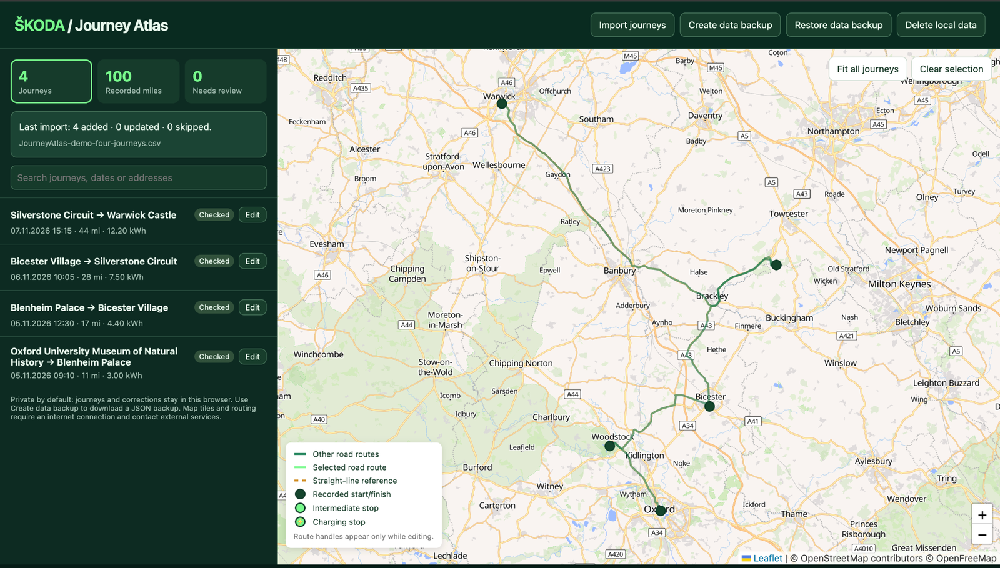
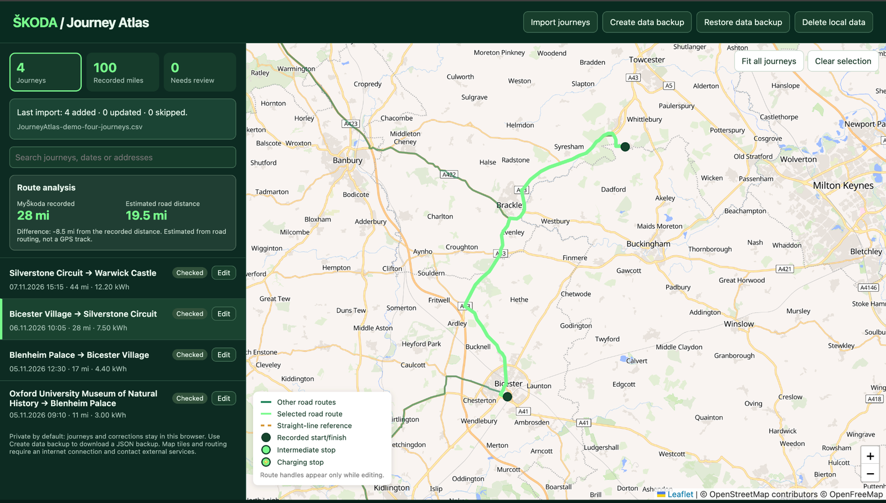

# Škoda Journey Atlas

**Explore your journeys. Revisit the roads you travelled. Make more of your MyŠkoda history.**

> **Public beta — v1.0.0-beta.1.** Journey Atlas is ready to try, and feedback from other Škoda owners is welcome. See the [user guide](docs/user-guide.md) for help getting started.

Journey Atlas is a free, independent companion to **MyŠkoda**. Import journey statistics from MyŠkoda, see your trips together on a map and build up a useful personal record. Select a journey to see its details, refine the road route with points and stops, and add your own observations.

## What you can do

- **Explore** your MyŠkoda journey history on an interactive map, with a searchable journey list and recorded mileage.
- **Reconstruct routes** using road routing, shaping points, intermediate stops, charging stops and turnarounds.
- **Review and enrich journeys** by adjusting locations or times, adding notes and marking records as checked or needing review.
- **Compare distances** recorded by MyŠkoda with estimated road distances.
- **Keep your history** in your browser and create a portable JSON backup whenever you want.
- **Import new CSV exports** with a preview that identifies duplicates and possible revisions.

## Get started

1. Select **Code → Download ZIP** on GitHub and extract the ZIP.
2. Open `index.html` in your browser, keeping the `css` and `js` folders alongside it.
3. Export journey statistics as CSV from MyŠkoda, then choose **Import journeys** in Journey Atlas.
4. Select a journey, explore the map and use **Edit** to personalise the route.
5. Choose **Create data backup** to download a JSON copy of your atlas for safekeeping.

No account, installation or web server is needed. Maps and road routing require an internet connection.

**[Read the illustrated user guide](docs/user-guide.md)** for a walkthrough of imports, journey editing, road routes and backups.

## A companion to MyŠkoda

MyŠkoda is the source of the journey statistics; Journey Atlas adds a different way to explore and organise them. In my experience, MyŠkoda can display intermediate points that are not included in its CSV export. Journey Atlas lets you add points to guide an estimated road route and add context to your travel history. It also helps you review records with missing location details. Routes calculated by Journey Atlas are estimates rather than recorded GPS tracks.

**Tested with:** a 2026 Škoda Enyaq running vehicle software 6.0.1 and MyŠkoda for iOS v8.18.0. Other vehicle and app versions may produce different exports.

## Your data and privacy

Journeys and corrections are saved in your browser. **Save corrections** updates that local copy; **Create data backup** downloads a JSON file you can keep and later restore. Map tiles and route calculations contact external services, including sending route coordinates to the routing provider. Take care not to share unredacted CSV exports or JSON backups publicly.

## What's next?

See the **[future enhancements backlog](docs/roadmap.md)** for ideas such as energy-efficiency analysis. Suggestions and bug reports are welcome via GitHub Issues; please use fictional or redacted examples.

## Licence and acknowledgements

Copyright © 2026 Mark Wilson. Released under the **[MIT Licence](LICENSE)**. Journey Atlas is an independent, unofficial project, not affiliated with or endorsed by Škoda Auto.

Built using [Leaflet](https://leafletjs.com/), [MapLibre GL JS](https://maplibre.org/), [OpenFreeMap](https://openfreemap.org/) maps based on [OpenStreetMap](https://www.openstreetmap.org/) data, and [OSRM](https://project-osrm.org/) routing. Their respective licences and usage terms apply. Created with the assistance of [ChatGPT](https://chatgpt.com/). Škoda and MyŠkoda are trademarks of their respective owners.
