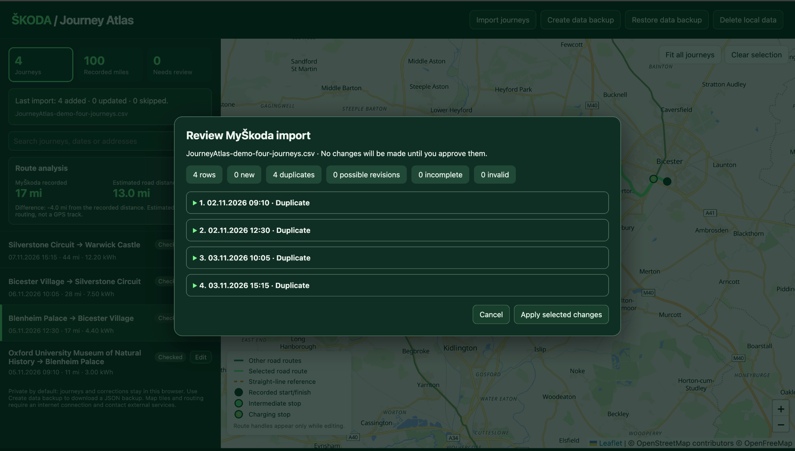
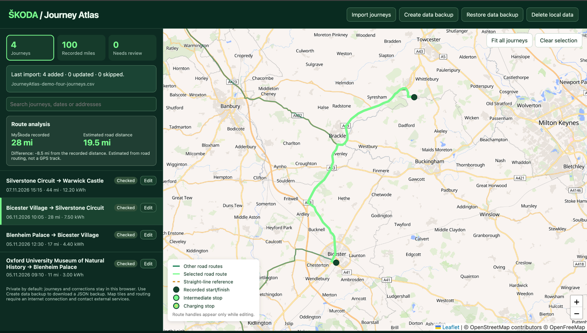
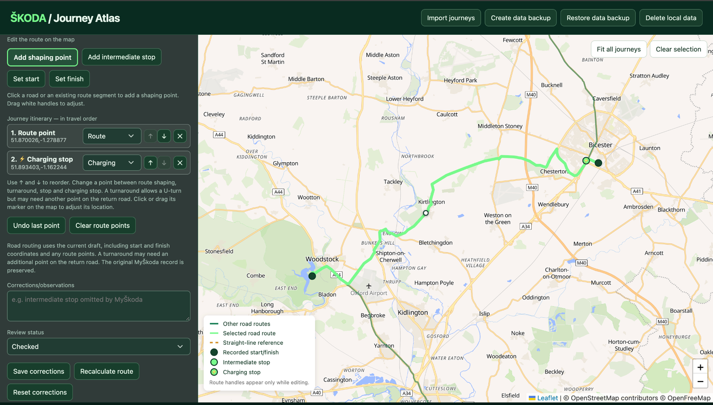

# Škoda Journey Atlas — user guide

[← Back to the project README](../README.md)

Journey Atlas complements MyŠkoda by turning exported journey statistics into an interactive map and a personal travel record. Explore your history, enrich journeys with notes and stops, and refine estimated road routes to reflect your travels.

## 1. Open Journey Atlas

Download the project ZIP from GitHub (**Code → Download ZIP**) and extract the files. Open `index.html` in a modern browser such as Chrome, Edge, Firefox or Safari. Keep the `css` and `js` folders alongside `index.html`.

The map and road-routing features need an internet connection. You don't need to install an application, register an account or run a web server.

**Important:** Journey Atlas saves your journeys in this browser's local storage. Before switching browsers, moving the project or clearing browser data, use **Create data backup** and retain the downloaded JSON file.

## 2. Export journey statistics from MyŠkoda

In the MyŠkoda mobile app, find the journey statistics/history area and use its export facility to obtain a **CSV** file of journey statistics. Save or share the CSV to a location you can access from the computer running Journey Atlas.

The exact MyŠkoda screens and export options can differ by app version and vehicle. Journey Atlas requires the **journey statistics CSV**, not a screenshot, PDF or JSON backup. If you can't find the export option, consult the help for your version of MyŠkoda.

## 3. Import journeys

1. Select **Import journeys** and choose the MyŠkoda CSV file.
2. Review the import preview before making changes. It shows how many records are **new**, **duplicates**, **possible revisions**, **incomplete** or **invalid**.
3. Expand a row to inspect it. New journeys are selected for addition by default. Exact duplicates are skipped. Possible revisions require your explicit decision; they are **not** applied automatically.
4. Select **Apply selected changes** to complete the import, or **Cancel** to leave your atlas unchanged.

You can import newer exports later. If a record looks like an updated version of an existing journey, Journey Atlas can compare the source fields and let you keep the existing journey, update its original MyŠkoda data while preserving your corrections, or import it separately. Check these choices carefully.

## 4. Explore the map

The left-hand panel lists journeys, newest first, with summary statistics at the top. Select a journey to highlight its route and see the **Route analysis** comparison between the recorded MyŠkoda distance and the estimated road distance. Use the search box to find journeys by date, name or address.

Use **Fit all journeys** to show the full set, **Clear selection** to deselect a journey and **Needs review** to filter records marked for attention. The map legend distinguishes other routes, the selected route, straight-line references and stop markers.

A **straight-line reference** marks a journey awaiting road-route calculation. Open the editor to refine its route.

## 5. Correct a journey

1. Select **Edit** beside the journey.
2. Review the original MyŠkoda values shown in the editor. You can change the journey name, start and finish coordinates, and corrected start and finish times.
3. Use **Set start** or **Set finish** and click the map to correct an endpoint. Alternatively, enter coordinates in the corresponding fields.
4. Add notes in **Corrections/observations** and set **Review status** to **Checked** or **Needs review**.
5. Select **Save corrections** to store the changes in your browser.

Edits remain drafts until saved. Closing the editor discards unsaved changes. **Reset corrections** removes saved changes for that journey and returns it to the original MyŠkoda values; it asks for confirmation.

## 6. Reconstruct a road route

MyŠkoda's CSV may contain start and finish locations without the intermediate points visible in its app. Journey Atlas uses a road-routing service to estimate a route, but the shortest or most plausible route may not be the one you actually took.

1. Open **Edit** for the journey and check the start and finish positions.
2. Select **Add shaping point** and click a road on the map that the route should pass through. Add further points as needed, in the order travelled.
3. Select **Add intermediate stop** to mark a stop, or change a point's type in the itinerary to **Stop**, **Charging** or **Turnaround**.
4. Drag route handles or itinerary markers to adjust positions. Use the up/down controls to correct the travel order, or remove a point that is in the wrong place.
5. Select **Recalculate route** if needed, review the map and the estimated distance, then **Save corrections**.

**Turnarounds:** If you retraced part of your route, you may need an additional shaping point on the return road to guide the routing service. **Undo last point** removes the latest itinerary point; **Clear route points** removes them all from the editing draft after confirmation.

**Tip:** Road routing provides an estimated path. Compare it with the recorded mileage and add shaping points to reflect the roads you remember taking.

## 7. Make the most of your MyŠkoda data

MyŠkoda provides the journey statistics that Journey Atlas builds upon. You may notice a few differences between what you see in the app and what appears in the exported CSV:

- **Information omitted from an exported record.** MyŠkoda may show intermediate points in its app but not include them in the CSV. Journey Atlas cannot import those points automatically; you can add them manually.
- **Incomplete or inaccurate records.** A journey may have a missing start or finish coordinate, unusual distance, or other information needing review. Journey Atlas flags certain problems so you can inspect and correct them.

If a journey you expected is absent, compare the CSV with the journey history in MyŠkoda before importing another export.

The **Needs review** filter and **Incomplete data** indicators help you find affected records. Correcting an endpoint or adding shaping points doesn't modify the original MyŠkoda source record; your changes are kept separately in the atlas.

These behaviours were observed with data from a **2026 Škoda Enyaq running vehicle software 6.0.1**, alongside **MyŠkoda for iOS** (version **8.18.0** was shown in the App Store during testing; the exact installed version was not independently verified). Other models and software versions may export different information.

## 8. Create, restore or delete data

The top navigation contains four data-management actions, in this order:

| Action | What it does |
| --- | --- |
| **Import journeys** | Adds or reconciles journeys from a MyŠkoda CSV export after review. |
| **Create data backup** | Downloads a **JSON** backup of the whole atlas, including journeys, saved corrections and import history. |
| **Restore data backup** | Loads a previously created JSON backup, **replacing** the atlas currently stored in this browser after confirmation. |
| **Delete local data** | Permanently removes the browser's stored journeys, corrections and import history after confirmation. Downloaded CSV and JSON files are unaffected. |

**Save corrections** is different from **Create data backup**: saving updates this browser's stored atlas, but does not download a file. Make regular JSON backups, especially before restoring, deleting, moving to another browser or making substantial changes.

## 9. Privacy and helpful tips

- Journey data remains in your browser unless you export it. Maps and road routing use external providers, and route calculations send coordinates to the routing service.
- **No journeys appear after reopening:** check you're using the same browser and storage context. If you have a JSON backup, use **Restore data backup**.
- **A route doesn't follow the roads you used:** add or move shaping points, check their order and recalculate.
- **Road routing fails:** check your internet connection and try again later. A straight-line reference may remain visible until routing succeeds.
- **An import is rejected:** check that you selected a MyŠkoda journey-statistics CSV with the expected columns, rather than a different export type.
- **An operation is blocked while editing:** save your corrections or close the editor first.

When reporting a problem on GitHub, describe the steps and browser version. **Never attach an unredacted journey CSV, JSON backup, registration number or personal location history** to a public issue.

[← Back to the project README](../README.md)
